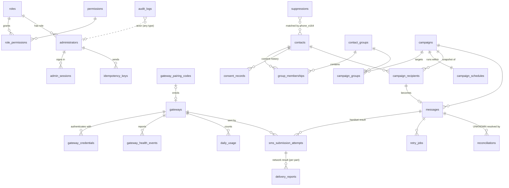

# Database design

PostgreSQL 16 (14+ works). The schema lives in `backend/migrations/` and is applied by the backend at startup (or `npm run migrate`). Applied migrations are checksummed; editing an applied file stops the backend, so schema changes are always a new numbered file.

## Entity-relationship diagram



## Tables

| Area | Table | Purpose |
|---|---|---|
| Access | `roles`, `permissions`, `role_permissions` | RBAC. Five built-in roles (below). |
| | `administrators` | argon2id password hash, lockout counters, `must_change_password`. |
| | `admin_sessions` | Opaque session tokens. Only the SHA-256 of a token is stored. |
| Gateways | `gateways` | One row per paired Android phone: selected SIM, pacing (`send_interval_ms`, `batch_limit`), pause flag. |
| | `gateway_pairing_codes` | One-time QR codes (hashed, expiring). |
| | `gateway_credentials` | Long-lived device tokens (hashed, revocable). |
| | `gateway_health_events` | Battery, signal, SIM and service state over time. |
| Recipients | `contacts` | `phone_e164` (validated) plus `phone_raw` (exactly what was entered). Invalid rows are kept with `is_valid=false` and a reason, never silently dropped. |
| | `contact_groups`, `group_memberships` | Many-to-many grouping. Tags are a `text[]` on the contact. |
| | `consent_records` | Append-only consent history per purpose. The latest record wins. |
| | `suppressions` | Opt-outs and blocks, **keyed by phone number** so they survive contact deletion and re-import. |
| Campaigns | `campaigns` | Template, consent purpose, recipient cap, segment budget, cost per segment, auto-pause thresholds, approval fields. |
| | `campaign_groups`, `campaign_schedules` | Targeting, start time, sending window, days, cooldowns. |
| | `campaign_recipients` | Frozen at approval: each candidate's INCLUDED/EXCLUDED decision with a reason, rendered text and segment count. |
| Delivery | `messages` | One per recipient. State machine plus lease fields. |
| | `sms_submission_attempts` | What Android's `sentIntent` reported, per attempt. |
| | `delivery_reports` | What the network's `deliveryIntent` reported, per message part. |
| | `retry_jobs`, `reconciliations` | Retry history and admin decisions on UNKNOWN messages. |
| | `daily_usage` | Segments submitted per gateway per day, for the daily airtime budget. |
| Platform | `idempotency_keys` | Stored responses for retried create requests. |
| | `audit_logs` | Append-only. A trigger blocks UPDATE, and blocks DELETE unless the retention purge flag is set. |
| | `app_settings` | Kill switch, default country, budgets, retention, test numbers. |

## Guarantees enforced by the database (not just the code)

- **One live contact per E.164 number** (partial unique index). Numbers that only *look* alike are different rows.
- **A recipient appears once per campaign** (`UNIQUE (campaign_id, contact_id)`), and so does **a phone number** (`UNIQUE (campaign_id, phone_e164) WHERE INCLUDED`).
- **One message per campaign recipient** (`messages.campaign_recipient_id UNIQUE`). Re-running campaign approval cannot double-queue.
- **Lease consistency:** a message is LEASED/SENDING exactly when it has a lease id and gateway (`CHECK`).
- **Valid states only.** Every status column has a `CHECK` list, so a typo such as `DELIVERD` is rejected.
- **One submission attempt number per message**, and **one delivery report per attempt part**. Duplicate callbacks from a phone are absorbed.
- **One active suppression per number.**
- **The audit log is append-only.**

## Message states

`QUEUED → LEASED → SENDING → SUBMITTED → (DELIVERED | FAILED)`, plus `UNKNOWN` and `CANCELLED`. `delivery_state` separately tracks `NONE / AWAITING_REPORT / NO_REPORT / CONFIRMED / FAILED`, so *submitted* is never shown as *delivered*. Phases 4 and 5 implement the transitions.

## Built-in roles

| Permission | Super admin | Campaign manager | Operator | Auditor | Viewer |
|---|:-:|:-:|:-:|:-:|:-:|
| contacts.read (masked numbers) | ✓ | ✓ | ✓ | ✓ | ✓ |
| contacts.read_full (unmasked) | ✓ | ✓ | | | |
| contacts.write / groups.write / consent.write | ✓ | ✓ | ✓ | | |
| contacts.delete / contacts.export | ✓ | ✓ | | | |
| campaigns.read | ✓ | ✓ | ✓ | ✓ | ✓ |
| campaigns.write / campaigns.operate | ✓ | ✓ | ✓ | | |
| campaigns.approve / messages.retry | ✓ | ✓ | | | |
| reports.export | ✓ | ✓ | | ✓ | |
| gateways.read | ✓ | ✓ | ✓ | ✓ | ✓ |
| gateways.manage / settings.write / admins.manage | ✓ | | | | |
| audit.read | ✓ | ✓ | | ✓ | |

## Indexes worth knowing

- `idx_messages_ready (priority, next_attempt_at) WHERE status='QUEUED'`: the queue pickup (`FOR UPDATE SKIP LOCKED`) only scans ready rows.
- `idx_messages_lease_expiry`: finds abandoned leases after a phone dies.
- `idx_messages_awaiting_report`: moves stale `AWAITING_REPORT` to `NO_REPORT`.
- `idx_contacts_tags` (GIN): tag filters.

## Backup and restore (Windows, Docker)

```powershell
# Back up (writes backups\smsgw-YYYYMMDD-HHMMSS.dump, verifies it, keeps 14 days)
.\scripts\backup.ps1

# Restore (stops the backend, restores in one transaction, restarts it)
.\scripts\restore.ps1 -File backups\smsgw-20261024-210000.dump
```

To schedule a daily backup, run this once in an elevated PowerShell. Change the folder path if yours differs:

```powershell
$dir = "$env:USERPROFILE\Documents\PROJECTS\ANDROID SIM SMS"
$action  = New-ScheduledTaskAction -Execute 'powershell.exe' -Argument "-NoProfile -ExecutionPolicy Bypass -File `"$dir\scripts\backup.ps1`"" -WorkingDirectory $dir
$trigger = New-ScheduledTaskTrigger -Daily -At 7pm
Register-ScheduledTask -TaskName 'SMS gateway backup' -Action $action -Trigger $trigger
```

**Protecting backups:** dumps contain names, phone numbers and consent history.
- Keep the project on a BitLocker-encrypted drive.
- Copy backups off the PC only to encrypted storage.
- Restrict the `backups` folder to the gateway administrators' Windows accounts.

**Test your restores.** A backup you have never restored is not a backup. The restore script is also used in the Phase 7 recovery test.

## Retention

Settings key `retention` (defaults: messages 365 days, health events 30, audit log 1,095, sessions 30). The scheduled purge job that applies these is part of Phase 6. Until then nothing is deleted automatically. The audit log can only be purged by that job; the database trigger refuses other deletes.
